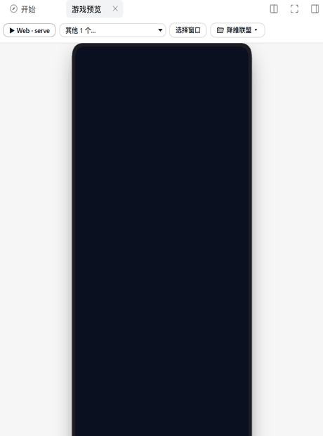
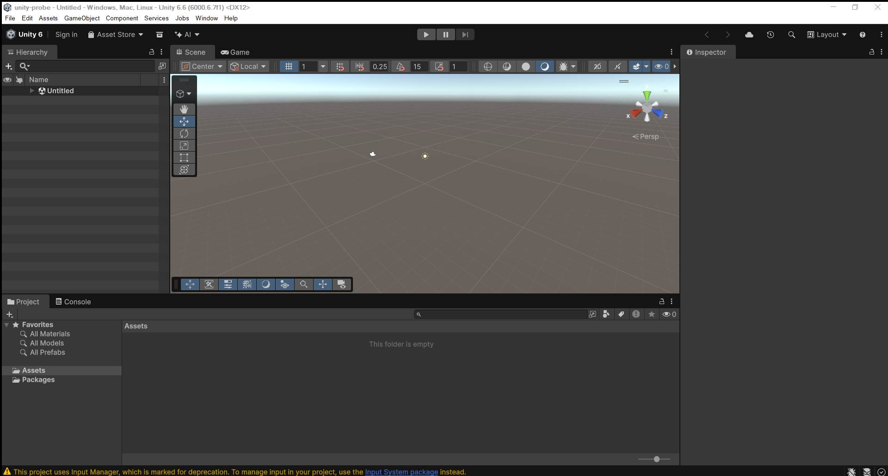
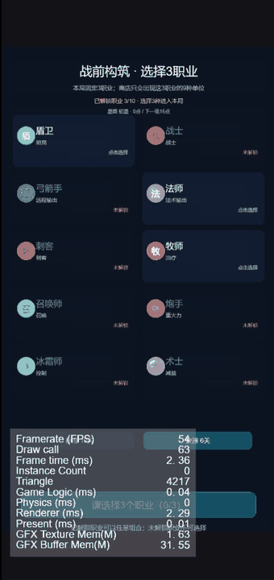
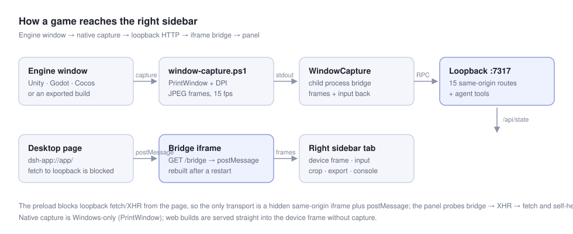

# DSH Game Preview

[](CHANGELOG.md)
[](LICENSE)
[](#requirements)
[](https://deepseek.com)
[](#requirements)

**Play your game inside the sidebar while the agent codes it.**

Run a Cocos / Godot / Unity / WeChat project, capture the native engine window, forward your mouse and keyboard, and iterate without ever leaving DeepSeek Harness. Then package it — Web zip, Android APK, or a project script like `build:taptap` — from the same panel.

Made by **邮差游戏工作室 / Postman Game Studio**.

**English** · [简体中文](README.zh.md) · [繁體中文](README.zh-TW.md) · [日本語](README.ja.md) · [한국어](README.ko.md) · [Deutsch](README.de.md) · [Español](README.es.md) · [Français](README.fr.md)

<p align="center">
  
</p>

### Try it in 60 seconds

```bash
# as a DSH bundle (needs DeepSeek Harness on Windows 10/11)
plugin_manager install_bundle(target: "github:davidmercer0620-ai/dsh-game-preview")
```

Or add the plugin-market index and install from **Settings → Plugins → Discover**:

```
https://raw.githubusercontent.com/davidmercer0620-ai/dsh-game-preview/main/docs/plugin-index.json
```

Then open a game project and click **▷ 预览** in the chat header.

Maintainers: `node scripts/release.mjs --yes` runs the checks, regenerates the
plugin index, tags, pushes and publishes the release (`--publish` adds npm).

- **Numbers, not adjectives** → [docs/CASE_STUDY.md](docs/CASE_STUDY.md) (15.2 fps Unity capture, 1m20s APK, 0.64 MB TapTap bundle, 14 croppable engine modules)
- **How it was built** → [docs/BLOG.md](docs/BLOG.md) (the iframe-bridge dead end, PrintWindow vs WGC, three white screens)
- **Skeptical questions answered** → [docs/FAQ.md](docs/FAQ.md) ("why not MCP?", "isn't this just a screen recorder?", "will it eat my CPU?")

<p align="center"><em>The 游戏预览 tab: engine/build chips, a real 390×844 phone viewport, and the run bar with packaging, console and export below.</em></p>

<p align="center">
  
</p>

<p align="center"><em>The Unity editor captured live into the sidebar — 1920×1030 at 15 fps, cropped to the Game view, keyboard and mouse forwarded.</em></p>

## Not a screen mirror

A senior developer reviewed an early build and said it plainly:

> *"The preview is just a screen recording in the sidebar — useless with two monitors. The agent drives Unity through scripts in the background, the editor does nothing until the final test, then it flashes and the scene is finished."*

That is right, and it changed the design. Watching a live feed of an idle editor is pointless. What you actually want is **the moment the agent was done**:

- **⏺ Result timeline** keeps a still only when the picture really changes (hash-gated, at most one every 4 s), so ten minutes of agent work becomes a handful of frames — a few hundred KB, near-zero CPU.
- **One click makes a GIF** of those frames, straight into your project folder, ready to paste into a review or a PR.
- **🗂 Project board** for the other half of the complaint — one screen, several games. Every workspace DSH knows appears as a card with its newest frame, frame count and last change; click one to switch the panel to it.
- Recording is on by default and change-gated (8 s floor), so there is nothing to press and an idle editor stores nothing.
- No continuous rendering, no second monitor required: open the panel when you want to *check the result*, not to babysit it.

<p align="center">
  
</p>

<p align="center"><em>Eight stills out of a 45-second recording of a finished build — what the agent produced, not a live feed.</em></p>

## Why this exists


Every engine has one loop that is faster than all the others. The panel picks that loop automatically:

| Engine | Fastest loop | What the preview does |
|---|---|---|
| Cocos Creator | Editor browser preview (~1 s) | Connects to `localhost:7456`, keeps the editor's HMR |
| Godot | F5 → native window (~2 s) | `godot --path .`, captures the window |
| Unity | Editor Play mode (~3 s) | `Unity.exe -projectPath`, captures the editor, follows the splash → editor window swap |
| WeChat mini game | DevTools build (~90 s) | Opens the project in WeChat DevTools |
| Web / static | dev server or plain files | Starts the script, or serves the folder as-is |
| Engine builds | `build/web-desktop/index.html` | Serves the exported bundle, PC or phone viewport |

**It never asks "which engine are you using?"** — detection decides; when nothing matches you get a manual URL.

## Features

| | |
|---|---|
| **Native window capture** | `PrintWindow` + a two-thread capture/encode pipeline, 15–24 fps; *sharp* (native size) or *smooth* (1100 px, ~24–30 fps) |
| **Play inside the panel** | 🖱 forwards mouse and keyboard to the captured window — DPI-corrected, with F1–F12, arrows and modifiers |
| **Crop to the Game view** | ✂ drag a rectangle over the capture and keep only that part; remembered per window title |
| **PC / phone / auto viewports** | Real 1280×720 and 390×844 logical viewports, scaled to fit — the game's media queries see a phone |
| **Auto start** | Opening the tab restores the last window or config for that project and starts it |
| **Dirty counter** | Saving does not reload; the panel shows how many changes are waiting, then one click reruns |
| **Agent tools** | `game_preview_run` / `game_preview_status` / `game_preview_stop` / `game_preview_windows` |
| **Package the game** | 📦 exports a Web zip, an Android APK (reusing the project's own `android/` shell), or a Windows EXE when the toolchain exists |
| **Project scripts, one click** | The export panel lists `package.json` scripts (build/release/verify/bench), `android/build.sh`, `build_apk.js` and `tools/build-platform.mjs` and runs them with a live log |
| **Bundle size budget** | Per-platform sizes against the store limits (WeChat/Douyin/TapTap 4 MB, web 32 MB), warn at 80%; click a row for the directory/extension/file breakdown |
| **Phone preview by QR** | Shares the running static build over the LAN behind a random token, shows a QR (host-side python-qrcode, no client dependency), expires after 30 minutes |
| **Build history** | Every export and project-script run is appended to `.dsh-game-preview/history.json`; the panel shows duration and byte delta |
| **Pipeline bar** | 改动 → 运行 → 自检 → 打包, live: a pulsing dot while the workspace is changing, parsed percent for long build jobs, elapsed seconds |
| **Project board** | A thumbnail wall of every workspace with its latest recorded frame; click to switch the panel |
| **Playtest replay** | `game_preview_playtest` replays `{wait, click, key, shot}` steps against a window and returns the screenshots plus the page errors collected during the run |
| **One-command check** | `game_preview_check` runs the whole chain — page errors, fps, a still, an optional playtest, a pixel diff against the previous check, bundle sizes and cropping candidates — and answers pass / warn / fail with evidence paths |
| **Visual diff** | Compares two frames (or the last two recorded) with Pillow: changed-pixel share plus a diff image, so a broken UI is a number, not an opinion |
| **Engine crop report** | Scans scenes, prefabs and scripts for engine component usage and lists which Cocos feature-cropping modules are unused, with the engine bundle size |
| **Agent eyes** | `game_preview_screenshot` saves the current frame into the project and returns its path; `game_preview_logs` returns the process tail, so the agent can inspect the game itself |
| **The page reports itself** | Every served document gets a tiny probe: uncaught errors with stacks, unhandled rejections, `console.error`, failed asset loads, and a measured frame rate. The chips row shows `⚠ 3` or `58fps`, and `game_preview_console` hands the same list to the agent |
| **Hotkeys** | `F` full-bleed · `R` reload · `Esc` leave |

## Install

### From the Discover tab (plugin market)

1. Enable the experimental market bundle once:
   `plugin_manager install_bundle(target: "@deepseek-ai/dsh-experimental-plugin-market-bundle")`
2. In **Settings → Plugins → Discover**, add this index URL:

```
https://raw.githubusercontent.com/davidmercer0620-ai/dsh-game-preview/main/docs/plugin-index.json
```

The index pins an exact commit per version, so an install from it is reproducible.

### From a local checkout

Requires DeepSeek Harness `0.2.x` and Node.js 22+.

```bash
# from a local checkout (links the folder into the profile)
dsh plugin --profile <profile> add /absolute/path/to/dsh-game-preview
```

or ask the agent inside DSH:

```
plugin_manager install_bundle(target: "C:\\path\\to\\dsh-game-preview")
```

Then reload the page (Ctrl+R): a ▶ button appears next to the session title, and **游戏预览** shows up in the right sidebar's “+”.

> Native capture, input forwarding and engine launching are **Windows 10/11 only**. Web previews work everywhere.

## Use it

1. Open the session whose workspace is your game.
2. Click the ▶ icon (or right sidebar → **+** → **游戏预览**).
3. The panel auto-detects the engine and starts the fastest loop.
4. Edit code — the counter says `●3`; press ▶ or let the agent call `game_preview_run`.
5. For Unity: press Play once in the editor, hit ✂ to crop the Game view, then 🖱 to play right there.

## Packaging

The 📦 导出 button opens three targets and shows live readiness for each:

| Target | What it does | Needs |
|---|---|---|
| Web zip | zips the detected static build into `<project>/dist` | nothing |
| Android APK | runs the project's own `android/build.sh` (or `gradle assembleDebug`) with `JAVA_HOME`/`ANDROID_HOME` injected, then copies the APK to `dist/` | JDK 17 + Android SDK + Gradle + an `android/` Gradle project |
| Windows EXE | builds the Cocos `windows` platform and copies the `.exe` | Visual Studio C++ + CMake + Cocos Creator |

Toolchain paths are discovered where Windows actually keeps them (`JAVA_HOME`, `D:/Android/sdk`, `D:/jdk*`, `%USERPROFILE%/.gradle/wrapper/dists`, `Program Files\\Java`), not just `PATH`.

Projects that pick their entry file by environment variable can use **构建参数…** (e.g. `ZAOWU_SRC=index_v5_0.html`); it is remembered per project.

## Configuration

Edit the row in your profile's `cordis.patch.yml`:

```yaml
- id: dsh-game-preview
  config:
    port: 7317             # control API start port (probes 16 ports)
    captureFps: 20         # target capture rate
    captureWidth: 0        # downscale before JPEG; 0 = native
    captureQuality: 70     # JPEG quality
    captureWaitMs: 30000   # how long to wait for the engine window
    godotExe: ''           # absolute path when not on PATH
    unityExe: ''           # <version>\Editor\Unity.exe
    cocosEditor: ''        # CocosCreator.exe
    wechatCli: ''          # WeChat DevTools cli.bat
```

## How it works

<p align="center">
  
</p>


```
DSH Web UI
├── session header ▶            ──┐
├── right sidebar tab "游戏预览"   │ opens the tab
│      ├── config bar / stage    │
│      └── playtest bar          │
└──────────────┬─────────────────┘
               │ iframe bridge (postMessage + long-poll)
               ▼
Host plugin
├── same-origin routes /api/game-preview/*
├── loopback control API 127.0.0.1:7317 (fallback)
├── workspace scan + watcher (dirty counter)
├── engine / dev-server lifecycle
├── host/window.js          capture bridge + input injection
└── host/window-capture.ps1 resident C# helper (DPI aware, two-thread pipeline)
```

The desktop app runs its page on `dsh-app://app/`, where `fetch` and `XMLHttpRequest` to loopback are intercepted. The panel therefore talks to the host through a hidden iframe served by the host itself (`GET /bridge`), and falls back to same-origin routes and the loopback API when that is unavailable.

## Known limits

- Windows-only for native capture, input and engine launching.
- Exclusive fullscreen windows capture as black; switch the game to borderless.
- The capture backend is `PrintWindow`: a 4K window at native size drops to ~10 fps — use *smooth*.
- Input forwarding covers keyboard and mouse (no gamepads); IME input is not translated.
- Only one level of nested projects is scanned.

## Development

```bash
node --check index.js && node --check client.js && node --check host/window.js
node scripts/harness.mjs          # host: control API, detection, capture, input, routes
node scripts/client-harness.mjs   # client: registration and every UI state
```

Reinstall the plugin after changing the host half; reload the page after changing the client half.

## License

MIT

## If this saves you alt-tabs

Star the repo — it is the signal that tells me to keep the Windows capture path alive. Issues with a screenshot are even better than stars: the panel can capture its own frame, so a bug report with `game_preview_screenshot` output is reproducible.

- Roadmap and the honest "what we will not build": [docs/ROADMAP.md](docs/ROADMAP.md)
- Changelog: [CHANGELOG.md](CHANGELOG.md)
- Built by 邮差游戏工作室 / Postman Game Studio, MIT licensed.
